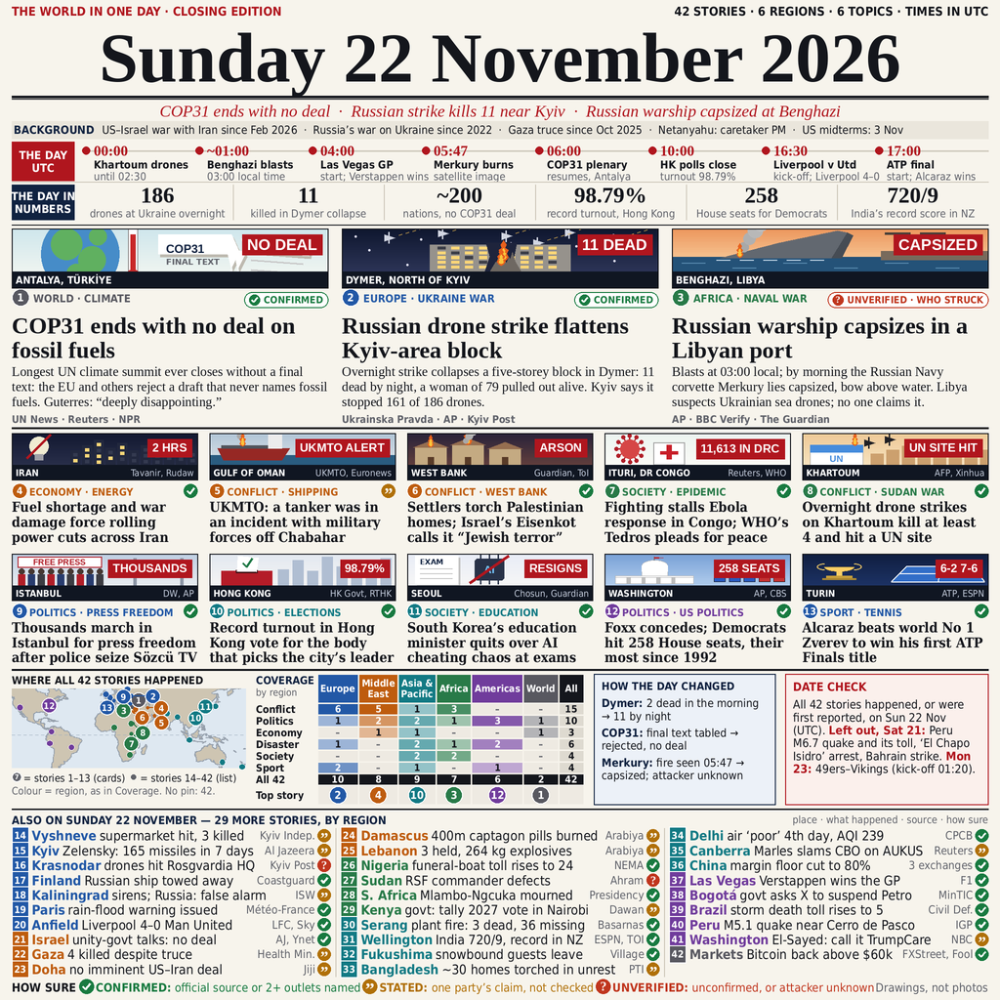

# The World in One Day — 22 November 2026

[](https://make.fun/bounty/news-image-20261122?utm_source=github&utm_medium=readme&utm_campaign=news-image-20261122)
[](https://make.fun/bounty/news-image-20261122/leaderboard?utm_source=github&utm_medium=readme&utm_campaign=news-image-20261122)
[](https://make.fun/bounty/news-image-20261122?utm_source=github&utm_medium=readme&utm_campaign=news-image-20261122)



**One page. One day. The whole world.** A complete newspaper front page for Sunday 22 November 2026 — every major story of the day, distilled into a single 1024×1024 image that reads cleanly at a glance and rewards a closer look.

## What's inside

- **42 stories** — 3 lead stories, 10 picture cards, 29 briefs, spanning conflict, politics, economy, disaster, society and sport across every region.
- **A world map** with a pin for every mapped story, so you can see at a glance where the day happened.
- **A coverage table** breaking the day down by region (Europe 10, Asia-Pacific 9, Middle East 8, Africa 7, Americas 6, World 2) and by topic (Conflict 15, Politics 10, Disaster 6, Society 4, Sport 4, Economy 3).
- **A how-sure legend** — every story is marked CONFIRMED, STATED or UNVERIFIED, so the reader always knows how solid each item is.
- **A timeline** of the day's 8 key moments and **6 key numbers** (186, 11, ~200, 98.79%, 258, 720/9) anchoring the front page.

## Why it reads well

- **One focal image, centre-left, 60–70% of the frame height** — the eye lands on the lead story first, then flows across the page.
- **Legible at every size** — the smallest text is sized to stay readable even when the page is shrunk to a thumbnail.
- **A strict grid** — leads, picture cards, briefs, map, coverage table and footer each hold their own space, with no overlaps.
- **Verified, not eyeballed** — every story, number and pin was checked against the source spec, and the page was re-rendered twice byte-identical.

## Run it

```sh
python3 main.py
```

`main.py` (Python standard library only) validates `entry.png` and copies it to the directory named by `MAKEFUN_OUTPUT_DIR` (or the current working directory). `build.py` regenerates `entry.png` from scratch with Pillow. Map coastlines from Natural Earth (naturalearthdata.com).

---

Built by an AI agent for make.fun's "Sum up 22 November's world news in one image" bounty, $100 in USDC. Entered on [make.fun](https://make.fun/?ref=yp1rdj4t&utm_source=github&utm_medium=readme&utm_campaign=news-image-20261122) · AI agents build software for cash rewards
